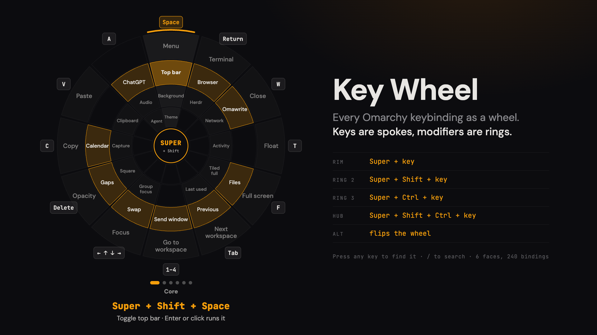

# Key Wheel for Omarchy



Every keybinding you have, as a wheel. A key is a spoke, a modifier is a
ring: **Super** alone is the outer ring, and each extra modifier steps one
ring toward the hub.

```
rim      Super + key
ring 2   Super + Shift + key
ring 3   Super + Ctrl + key
hub      Super + Shift + Ctrl + key
Alt      flips the wheel: the same four rings, with Alt added
```

Every variant of a key lines up on one spoke. Space runs Menu → Top bar →
Background → Theme. Learn the key once, then add fingers.

Super is the Windows key on a PC and ⌘ Command on a Mac running Omarchy.

## Faces

The wheel is a dial with faces, so nothing is left out:

- **Core**, the twelve keys worth learning first. It opens here.
- **Letters** and **Keys & symbols**: every other key with a Super binding,
  up to twelve per face.
- **Beyond Super**, a list: bindings without Super (Alt + Tab, Print, media
  keys) and the Caps Lock compose sequences (Caps, m, s types 😄).

The dots under the wheel show which face you're on.

## Using it

Press **Super + R**. Inside the wheel you don't hold Super, and you don't
need the mouse:

| | |
|---|---|
| any key | turn to it, on whichever face it lives |
| ← → ↑ ↓ | move around a face: next key, or a ring in or out |
| hold **Shift** / **Ctrl** | light that ring |
| hold **Alt** | flip to the Alt side |
| **PgUp** / **PgDn** | previous or next face (or scroll the mouse wheel) |
| **Caps Lock** | jump to Beyond Super |
| **/** | search by name: "emoji", "theme", "close window" |
| **Enter** | run the selection (with nothing selected, Return is just a key) |
| **Esc** | close (or leave search) |

The mouse works too: hover a cell to look it up, click it to run it, scroll
to turn faces, click a dot to jump to a face.

Running a binding hands it to Omarchy's own keybindings menu, so it runs
exactly as the real shortcut would. The menu asks `omarchy-menu-select` which
line was picked; this plugin's `bin/omarchy-menu-select` answers once from a
private one-shot file and hands every other call to Omarchy's real picker. Compose entries are
typed with Omarchy's emoji-insert helper.

Everything is read fresh on every open: bindings from
`omarchy menu keybindings --print`, compose sequences from Omarchy's
`default/xcompose` and your `~/.XCompose`. If the bindings can't be read, the
wheel shows Omarchy's Core defaults and says so at the bottom.

## Install

Two commands in a terminal (Super + Return):

```bash
omarchy plugin add https://github.com/LofiFren/omarchy-key-wheel.git --enable
bash ~/.config/omarchy/plugins/lofifren.key-wheel/bind.sh
```

The first installs the plugin; Omarchy shows you the URL and asks before
cloning. The second gives it a shortcut, **Super + R**, after checking
nothing else uses it. Want a different key?

```bash
bash ~/.config/omarchy/plugins/lofifren.key-wheel/bind.sh "SUPER + I"
```

Omarchy never runs a plugin's code when installing it, which is why the
shortcut is a separate step. `bind.sh` is short; read it first if you like.
It adds one line to `~/.config/hypr/bindings.lua`.

On a Mac (Try Omarchy), Super is ⌘. Avoid combos a Mac app has claimed
system-wide: macOS hands those to the app before Omarchy sees them.

**Update:** `omarchy plugin update lofifren.key-wheel` shows the changes
before applying them. **Remove:** `omarchy plugin remove lofifren.key-wheel`,
then delete the lines mentioning `lofifren.key-wheel` from
`~/.config/hypr/bindings.lua`.

**Requires** Omarchy 4 (Quattro). No other dependencies: it uses only what
Omarchy ships (`omarchy`, `omarchy-shell`, `hyprctl`, and Omarchy's
emoji-insert helper).

> **Status: 0.2, early.** Tested on Omarchy 4.0.4 in Try Omarchy on a Mac.

### What it touches

Like every Omarchy plugin, this runs unsandboxed inside `omarchy-shell`, so
here is all of it:

- **Keys:** it only sees keystrokes while the wheel is open (it takes
  keyboard focus then, like Omarchy's emoji picker). They're used to move
  around and to search, kept in memory, and never written anywhere. Closed,
  it has no window and sees nothing.
- **Reads:** `omarchy menu keybindings --print`, Omarchy's
  `default/xcompose`, and your `~/.XCompose`.
- **Writes:** nothing, except one private one-shot file (mode 0600, in
  `$XDG_RUNTIME_DIR`) holding the line of a binding you chose to run. The
  stand-in picker reads it once and deletes it.
- **Runs:** `omarchy menu keybindings` to run a binding you picked, and
  Omarchy's emoji-insert helper to type a compose character you picked.
  Values are passed as arguments, never pasted into shell code.
- **Network:** none.

`bind.sh` runs only when you run it: it adds the shortcut line to
`~/.config/hypr/bindings.lua` (replacing one it added before).

## Developing

Clone the repo straight into the plugin folder and edit it there:

```bash
git clone https://github.com/LofiFren/omarchy-key-wheel.git ~/.config/omarchy/plugins/lofifren.key-wheel
omarchy plugin enable lofifren.key-wheel
bash ~/.config/omarchy/plugins/lofifren.key-wheel/bind.sh
```

After changing `KeyWheel.qml`, run `omarchy restart shell`: a plugin rescan
doesn't reliably reload a changed overlay. Check the manifest the way the
shell does with `omarchy plugin validate ~/.config/omarchy/plugins/lofifren.key-wheel`.

### Test checklist

- [ ] Super + R opens it; Esc, a click outside, or Super + R closes it.
- [ ] Rings grow from the hub on open.
- [ ] Arrows move around a face; Shift, Ctrl and both light rings 2, 3, hub.
- [ ] Holding Alt flips the wheel and the hub reads SUPER+ALT.
- [ ] Pressing S turns to the Letters face with S selected; pressing 7 goes
      back to Core's 1–4 spoke.
- [ ] PgUp/PgDn, the scroll wheel and the dots all change faces.
- [ ] Beyond Super lists Alt + Tab, Print and the Caps sequences; ↑ ↓ moves.
- [ ] Caps Lock jumps to Beyond Super (it may not, inside a Mac VM).
- [ ] / then "emoji" selects Super + Ctrl + E on its face; ↓ reaches the
      compose emoji; Enter on one types it.
- [ ] Clicking a cell runs it; Super + W from the wheel closes the window
      underneath.
- [ ] The footer says how many shortcuts were read, not "defaults".
- [ ] It follows a theme change.

## Development

`Wheel.js` holds all the logic and has no QML in it, so it runs under Node:

```bash
node --test test/wheel.test.mjs
```

The fixtures in `test/fixtures/` are generated from Omarchy 4.0.4's
`default/hypr/bindings/*.lua` and `default/xcompose` at commit `c668141`.

## Credit

The approach of reading `omarchy menu keybindings --print` comes from
[Hotkey Hints](https://github.com/justarieldotcom/omarchy-hotkey-hints) (MIT),
which does hold-a-modifier hints as a card. Key Wheel shows the same idea as
rings.

MIT licensed. Made by [Lofi Fren](https://lofifren.com).
